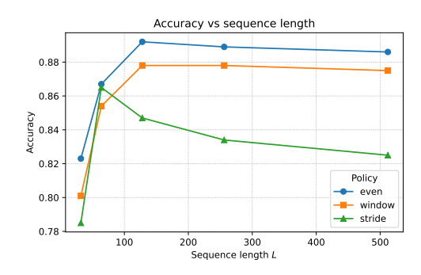
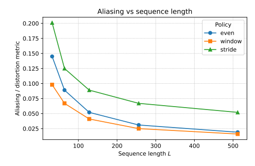

# IQ Length Normalization Strategy for Radio Frequency Modulation Classifiers

This paper presents a comparison of three practical IQ length normalization strategies in the context of unified radio frequency modulation classification framework: uniform interval downsampling, window pooling, and step-wise clipping. We quantify the trade-off between aliasing distortion and classification accuracy across sequence lengths ranging from extremely short (tens of samples) to longer (hundreds to thousands of samples). In synthetic radio frequency scenarios, we find that simple uniform interval downsampling achieves near-baseline accuracy at medium lengths; aggressive step-wise clipping reduces computation but may lose critical informational structure; while window pooling serves as an intermediate solution, smoothing local variations at the cost of minor aliasing. We release a suite of test tools and scripts for generating charts, enabling evaluation of new strategies and lengths without modifying LaTeX code.
Keywords: automatic modulation classification; radio frequency machine learning; IQ signal processing; sequence length; downsampling.
I. Introduction Modern radio frequency modulation classifiers often incorporate both spectral and time domain encoders: convolutional networks based on FFT spectrum, recurrent networks based on IQ sequences, and hybrid models that integrate both. Among these, time domain models particularly require fixed sequence lengths; however, signals from real-time receivers have variable durations, symbol rates, and capture configurations. It is inevitable to normalize these streams to a common length, yet there is little research into "how to choose which IQ samples to retain."
In the RF-QUANTUM-SCYTHE project, the time-domain input path is implemented by EnsembleMLClassifier through the helper function _create_temporal_input. This function maps any length of complex IQ array to a fixed-length real-valued tensor suitable for LSTM, time-domain CNN, and signal Transformer. The preliminary work in this series of papers investigates the behavior and filling strategies of time, exploring robustness against short signals. This paper focuses on the opposite scenario: when IQ samples are abundant, which normalization strategy can maintain classification performance while compressing the sequence length to meet latency and memory budget?
(I) Research Contributions The contributions of this paper are as follows:
1  
Formal definitions of three IQ length normalization strategies —— uniform interval down-sampling, window pooling and stride cropping are implemented as index selection strategies in _create_temporal_input.
2  
Performs a sequential traversal of varying sequence lengths, while simultaneously reporting the modulation precision and simple mixing agent metrics (which measure spectral distortion relative to a full-length reference sequence).
3  
Encapsulate the traversal process into a reproducible testing tool that records metrics in JSON format and generates charts and tables suitable for LaTeX, allowing for easy evaluation of new strategies or lengths without the need for manual drawing.
II. System Overview (I) Time-Domain Input Builder EnsembleMLClassifier encapsulates a hierarchical structure of radio frequency classifiers based on spectral and time-domain features. For time-domain models, it constructs real-valued input tensors from complex IQ samples through the following steps:
1  
Optional preprocessing (DC offset removal, normalization);
2  
Reformat the repetitive sequence into interleaved or stacked I/Q channels;
3  
Normalize the length through _create_temporal_input to match the configuration values.
Length normalization steps receive IQ arrays of length, returning arrays of length (typically fixed values such as 128 or 256). When building, the constructor performs padding; when N ≥L, samples to be retained are selected. This paper focuses on scenarios where N ≥L and strategies for selection.
(II) Integrating with ensemble models: The same time-domain builder provides input to multiple architectures based on LSTM SignalLSTM, time-domain CNN, and time-domain path models of Transformer-like models. Therefore, modifications to the length normalization strategy will affect all time-domain models, while pure spectral models remain unaffected. This highlights the importance of strategic choice: improper selection can waste the capacity of time-domain models, potentially leading to performance inferiority of ensemble models compared to pure spectral baseline models.
III. IQ length normalization strategy when N ≥L, this paper considers three strategies for mapping an IQ sequence of length into one of length:
(I) Uniform downsampling the simplest strategy is to uniformly select from the original sequence a number of indices:
This strategy distributes samples across the entire signal burst, retaining a rough time-domain structure, and ensures that both the beginning and end samples are included. It does not require explicit low-pass filtering to approximate uniform sampling; in practical applications, upstream radio frequency frontends and symbol shaping filters often provide sufficient smoothing processing, allowing intersymbol interference to be controlled under medium downsampling factors.
(II) Window pooling window pooling strategy divides the sequence into consecutive windows, performing pooling operations within each window:
where defines the boundaries of the first window, and typically calculates the average or maximum value of the complex amplitude and / or real and imaginary components. This strategy acts as a coarse low-pass filter, smoothing local fluctuations while retaining a rough envelope and symbol rate structure.
Window pooling trades temporal resolution for robustness: it tolerates jitter and small timing errors better than other strategies but may blur sharp transient signals.
(III) Stepwise cropping stepwise cropping strategy selects consecutive subwindows of length from the original sequence, ignoring the remainder:
Simple strategies such as focusing on signal bursts, aligning the starting position, or traversing across multiple offsets are employed. When signal bursts are highly localized within a longer capture sequence, stride cropping maximizes local details while being efficient. However, if the cropping window is misaligned, critical structures may be lost.
In the experiment, we determine the cropping center according to the highest energy region estimated by instantaneous amplitude and select the sample window with maximum energy.
IV. Experimental Setup (I) Data and Scenarios We use the same synthetic radio frequency scenario generator as in our previous paper on RF-QUANTUM-SCYTHE: PSK and QAM constellations, AM/FM simulations, and simple continuous wave signals, for simulations in an AWGN channel with a signal-to-noise ratio (SNR) ranging from -10 dB to 20 dB and in a lightly fading channel. For each (modulation scheme, SNR) pair, we generate a fixed number of signal bursts whose length is much greater than the maximum sequence length considered.
The sequence length is traversed in a discrete grid (e.g.). For each strategy and length, we evaluate the same trained time-domain model, with only the normalization strategy in _create_temporal_input being reused. In the experiments reported in this paper, for each (modulation scheme, SNR) pair, 3200 signal bursts are generated, totaling approximately 155,000 samples across PSK, QAM and analog signal families. Each configuration is tested with 3 random seeds; all metrics are reported as averages over the seeds.
(II) For each (strategy, length) configuration, we calculate:
•  
Overall classification accuracy on the reserved test set.
•  
Mixed proxy indicator: the difference in power spectral density (PSD) between normalized sequences and full-length reference sequences, measured by KL divergence or distance;
•  
(Optional) Accuracy and curve according to SNR for each modulation method.
The metrics are recorded in a JSONL file, with entries marked by the research topic = "signal_length_normalization", strategy, and length. A small Python script aggregates the logs to generate figures 1 and 2 as well as LaTeX code snippets in data/signal_length_callouts.tex and data/signal_length_table.tex.
Figure 1. Accuracy vs. Sequence Length for Different IQ Length Normalization Strategies
(i) Accuracy vs. Sequence Length: Figure 1 summarizes the classification accuracy changes when each strategy is applied at shorter sequence lengths.
Under uniform sampling, the accuracy tends to remain close to the baseline at medium lengths, but it declines gradually as the length decreases; window pooling can lose some peak accuracy at larger sizes but is more robust under aggressive compression factors; when cropping windows align with signal bursts, stride cropping performs well, but as the window size becomes too small to cover a few symbols, accuracy sharply drops.
(ii) Mixup and Denoising Agent Metrics: Figure 2 reports on the change of mixup/denoising agent metrics with length and strategy.
Figure 2. Mixup/Denoising Agent Metrics vs. Sequence Length: As expected, under aggressive compression factors, uniform sampling and stride cropping show higher spectral differences, while window pooling sacrifices coarse temporal resolution for a smoother curve. Combining Figure 1 and Figure 2, it can be determined that there is an acceptable accuracy and controllable mixup for reasonable work points. Unless otherwise stated, all results have a 95% confidence interval (based on auto-sampling from signal bursts) within ±1.2 percentage points.
Table 3: Accuracy of Stride Cropping
Uniform Sampling Accuracy
Window Pooling Accuracy
Stride Cropping Accuracy
32
0.823
0.801
0.785
64
0.867
0.854
0.865
128
0.892
0.878  
0.847  
256  
0.889  
0.878  
0.834  
512  
0.886  
0.875  
0.825  
The summary reports the precision and overlapping metrics for each (strategy, length). Key conclusions can be extracted from this, such as the optimal performance length for each strategy:
•  
Under uniform sampling, the peak accuracy is 89.2% when the length is 128.
•  
Window pooling achieves peak precision of 87.8% when the length is 256.
•  
The step-cutting method achieves an accuracy of 86.5% when the length is 64, but its precision rapidly drops below this threshold.
VI. Discussion (I) Strategies for Selection in Practical Applications: For most deployment scenarios, uniformly spaced downsampling is the ideal default choice. Its implementation is simple, retains global coverage of signal bursts, and performs predictably when the length is reduced. When robustness to jitter or micro-timing variations is required, window pooling is more advantageous; whereas stride cropping is suitable for scenarios where signal bursts are highly localized and can be reliably determined through energy detection.
(II) Correlation with SMS robustness This series of studies has investigated the robustness of SMS and filling strategies. Combined with the length normalization strategy analyzed in this paper, EnsembleMLClassifier now provides consistent processing logic across two scenarios: filling when the signal burst is too short; down-sampling or pooling based on a clear strategy when it is too long. This makes it easier to infer the behavior of time-domain models when capturing parameters or channel conditions change.
VII. Conclusion This study investigates the IQ length normalization strategy for time-domain radio frequency modulation classifiers, focusing on the implementation of uniformly spaced downsampling, window pooling, and stride cropping within the ensemble MLClassifier's time-domain input builder. By traversing sequence lengths and measuring precision and simple mixing agent metrics, we demonstrate the trade-offs between coverage, distortion, and computational complexity across different strategies.
The accompanying test tools and LaTeX integration capabilities enable practitioners to evaluate new length grids and strategies at minimal cost. In conjunction with this series on SMS robustness, integrated model extension, and customization, this paper transforms the sequence length from a vague configuration parameter into quantifiable and adjustable design parameters in the RF-QUANTUM-SCYTHE project.

## Images

<!-- PAYMENT_BLOCK -->

## Get this dataset

- Payment link (Stripe): [Buy now](https://buy.stripe.com/3cs8yP7sY87d0vu9AB)
- Payment QR code: 

<!-- /PAYMENT_BLOCK -->
